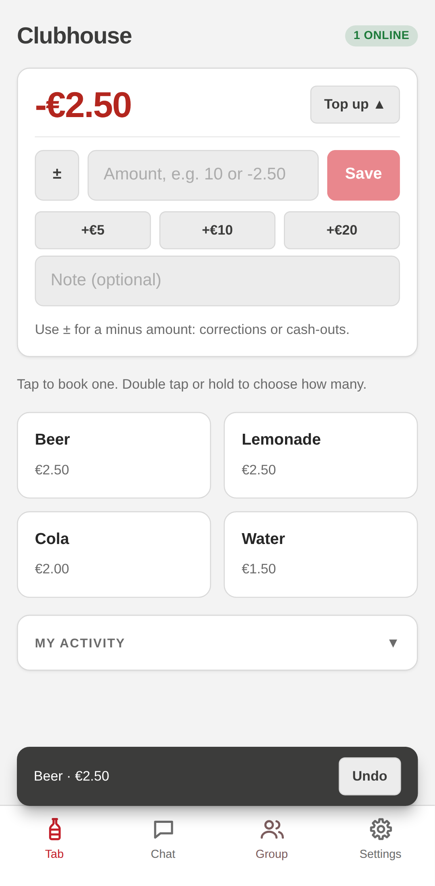
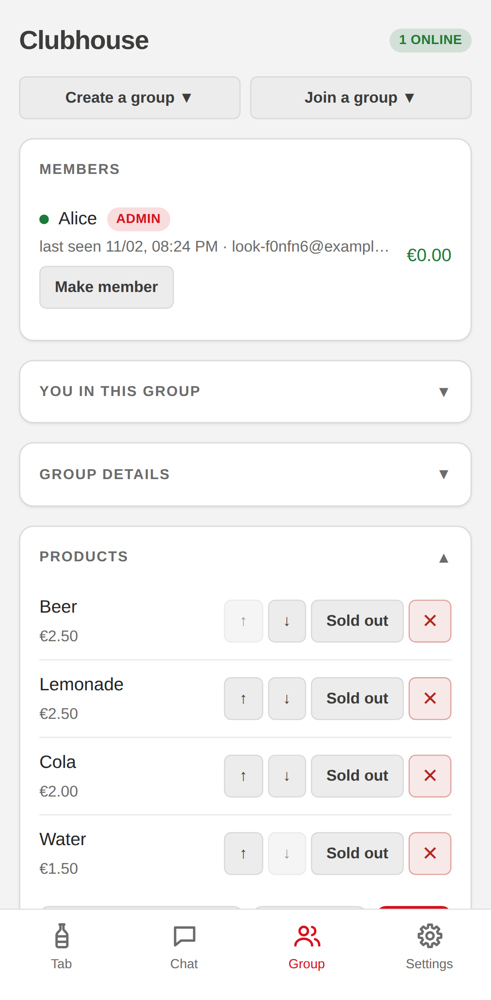

# Bardesk

A self-hosted, trust-based cashbox for small communities.

Bardesk is an honesty box on the phone: members of a club, an office, a hackerspace or a
community pub book what they take, top up money and see their balance. It is a web app
(PWA) that you install from the browser. You run the small server yourself.

<p>
  
  &nbsp;
  
</p>

- Book a product with one tap (double tap or hold for several), undo within 8 seconds.
- Top up, corrections, cash-outs; balances for every member.
- Groups with invites (link or QR code), products and prices, a log with CSV export and a
  simple group chat.
- **Local-first and private:** the group data lives only on the members' phones. The server
  only relays end-to-end encrypted messages between members who are online at the same
  time. It cannot read them and stores nothing about groups, bookings or balances.
- Works offline. Syncs when members are online at the same time.
- German and English. Name, colours, icon, currency and more are configurable.

Contents: [Try it locally](#try-it-locally) · [Self-hosting](#self-hosting) ·
[Configuration](#configuration) · [Headless client](#optional-headless-client) ·
[How it works](#how-it-works) · [Security model](#security-model) ·
[Local-first](#local-first) · [Limits](#limits) · [Contributing](#contributing) ·
[Licence](#licence)

## Try it locally

You need Docker. No domain and no mail server are needed: without `SMTP_HOST` the server
writes the login code to its log.

```bash
docker run --rm -p 127.0.0.1:8000:8000 -v bardesk-data:/data ghcr.io/pitrade/bardesk
```

Open <http://localhost:8000> in your browser (a phone-sized window works best) and choose
"Continue in the browser". Enter any email address. The terminal shows a line like

```
No mail configured. Login code for alice@example.org: 123456
```

Enter that code. To try syncing, open a second browser (or a private window) and log in
with another email address: each browser is a separate device.

Phones on your network cannot use `http://<your computer>:8000`: browsers allow the
cryptography the app needs only on HTTPS or on `localhost`. For phones, set up a server
as described below.

## Self-hosting

You need a server with Docker and Docker Compose 2.23 or newer (`docker compose version`;
the Caddyfile is part of `docker-compose.yaml`), a domain that points to it (ports 80 and
443 open) and an SMTP account for the login emails. You need two files, no build:

```bash
mkdir bardesk && cd bardesk
curl -fsSLO https://raw.githubusercontent.com/pitrade/bardesk/v1.0.0/docker-compose.yaml
curl -fsSL https://raw.githubusercontent.com/pitrade/bardesk/v1.0.0/.env.example -o .env
# edit .env: set DOMAIN, BASE_PATH, SMTP_* and the look
docker compose up -d
```

By default the bundled [Caddy](https://caddyserver.com/) gets the HTTPS certificate
automatically. To use your own reverse proxy instead, see below. Open
`https://<DOMAIN><BASE_PATH>` on your phone and install the app to the home screen first
(the login screen explains how).

**Updates:** the image version is `BARDESK_VERSION` in `.env` (default `1.0`: patch updates
only). For a new minor or major version, change `BARDESK_VERSION` (and fetch the new
`docker-compose.yaml` from the release tag). Then run `docker compose pull && docker compose up -d`. Open apps update themselves
within about 25 seconds before they sync again (the relay lets only the deployed app
version sync).

**Build it yourself:** in a clone of this repository,
`cp compose.override.example.yaml compose.override.yaml`, then `docker compose up -d --build`.

**Backup:** the server keeps only a small SQLite file (`email → public key` and pending
login codes) in the `data` volume. If you lose it, everyone logs in again; the group data
stays on the phones. Members can export their groups as a file in the app (Settings →
Backup). A group with only one member exists only on that member's phone, so export it.

**Legal links:** in some countries (for example Germany) a public website must name who
runs it (imprint) and explain how it handles personal data (privacy policy). Set
`IMPRINT_URL` and `PRIVACY_URL` to show these links on the login screen and in the settings.

### Configuration

Settings go into `.env` (see [`.env.example`](.env.example)). After a change run
`docker compose up -d`. At every start the container writes name, look, `BASE_PATH` and
`DB_NAME` into the app (the render step). Installed apps then update themselves, like after
an update.

| Setting | Meaning |
|---|---|
| `DOMAIN` | Your domain, e.g. `tab.example.org` |
| `BASE_PATH` | Where the app lives on the domain: `/` (default) or e.g. `/tab/` |
| `SMTP_HOST`, `SMTP_PORT`, `SMTP_SECURITY` | Mail server; security `starttls` (587), `ssl` (465) or `none`. Empty `SMTP_HOST`: login codes only go to the log |
| `SMTP_USER`, `SMTP_PASSWORD` | Mail login |
| `FROM_EMAIL`, `FROM_NAME` | Sender of the login emails |
| `AUTH_RATE_LIMIT_PER_MINUTE` | Login code requests per minute and IP address (default `10`; `0` = off). Behind a reverse proxy the server must see real client IPs, otherwise all users share one limit |
| `APP_NAME`, `APP_SHORT_NAME` | Name of the app (also in the login emails) and the label under the home-screen icon (max. 12 characters) |
| `COLOR_PRIMARY`, `COLOR_SECONDARY` | Main colour (buttons, accents) and second colour (headings, notices) |
| `THEME` | `light` (default) or `dark` |
| `DEFAULT_LANGUAGE` | `de`, `en` or `auto` (phone language) |
| `CURRENCY` | ISO code: `EUR`, `CHF`, … |
| `TOPUP_AMOUNTS` | Quick top-up buttons, e.g. `5,10,20` |
| `IMPRINT_URL`, `PRIVACY_URL` | Imprint and privacy policy links (login screen, settings) |
| `DB_NAME` | Name of the database on the phones (IndexedDB), default `bardesk`. A phone keeps the name it got at its first start; after a change only new phones use the new name (the others show a notice) |

Own icon: put `icon.png` (a square PNG, at least 512 px) into the `branding/` folder next
to `docker-compose.yaml`, then run `docker compose restart app`.

### Own reverse proxy (nginx, Traefik, …)

The app needs HTTPS, so it always runs behind a reverse proxy. Instead of the bundled Caddy
you can use your own:

1. In `.env`, set `COMPOSE_PROFILES=` (empty) and, if needed, another `BARDESK_PORT`.
2. Run `docker compose up -d`. The app listens on `127.0.0.1:BARDESK_PORT` only.
3. Forward `https://<DOMAIN><BASE_PATH>` to `http://127.0.0.1:<BARDESK_PORT>/`, without the
   `BASE_PATH` prefix. Pass `Host`, `X-Forwarded-For` and `X-Forwarded-Proto`, and allow
   WebSocket upgrades (the app syncs over `<BASE_PATH>api/ws`).

Example for nginx with `BASE_PATH=/tab/`:

```nginx
location /tab/ {
    proxy_pass http://127.0.0.1:8000/;
    proxy_http_version 1.1;
    proxy_set_header Upgrade $http_upgrade;
    proxy_set_header Connection $connection_upgrade;  # map in the http block
    proxy_set_header Host $host;
    proxy_set_header X-Forwarded-For $proxy_add_x_forwarded_for;
    proxy_set_header X-Forwarded-Proto $scheme;
    proxy_read_timeout 120s;
}
```

`$connection_upgrade` is the usual nginx map
(`map $http_upgrade $connection_upgrade { default upgrade; '' close; }`).

**Port 8000 must stay on `127.0.0.1`.** The server trusts the `X-Forwarded-For` header of
every sender (the proxy's IP is not fixed), so only the proxy on this machine may reach it.

The server also reads these (the Docker image sets them):

| Setting | Meaning |
|---|---|
| `DATABASE_URL` | SQLite database, default `sqlite:///./bardesk.db` (image: `/data/bardesk.db`) |
| `FRONTEND_DIR` | Serve the built app from this folder (image: `/app/static`); also where the render step writes by default |
| `FRONTEND_VERSION_FILE` | `version.json` of the deployed app, if the app is served by another web server; only that version may sync |
| `BRANDING_DIR` | Folder with the own `icon.png`, default `../branding` (image: `/app/branding`) |
| `LOGIN_CODE_EXPIRY_MINUTES` | How long a login code is valid, default `5` |

### Without Docker

Build the app (`cd frontend && npm ci && npm run build`), then write the settings into it
with the render step. Run it again after every deploy and after every settings change:

```bash
cd backend && ./venv/bin/python -m app.render ../frontend/dist
```

It reads the same settings as the server (environment or `backend/.env`). Serve
`frontend/dist` with your web server under `BASE_PATH` (unknown paths get `index.html`),
proxy `<BASE_PATH>api/` (with WebSockets) to the backend's `/api/`, and set
`FRONTEND_VERSION_FILE` to `frontend/dist/version.json`.

## Optional headless client

[`bot/`](bot/README.md) contains a Bardesk client without a screen (Node.js or Docker). It
is an ordinary group member that stays online and can book for members. It can run anywhere,
for example as a bar station, or next to a device with buttons or a touchscreen that calls
its small HTTP API on the local network. See [`bot/README.md`](bot/README.md).

## How it works

Every group is an append-only log of entries ("Alice bought a beer", "Bob topped up 10").
Every member's phone holds the full log in the browser's database (IndexedDB). Balances,
members and products are computed from the log by a deterministic replay, so every phone
gets the same result.

Phones sync live, peer to peer, through the server's relay. Each message is encrypted for
exactly one recipient. The relay forwards messages but stores nothing. Login is by email
code; the phone creates a key pair, and the server only stores `email → public key`.

```
 phone A ──┐                          ┌── phone B
 (log in   │  encrypted messages      │  (log in
 IndexedDB)├──────► relay ◄───────────┤  IndexedDB)
           │   (FastAPI, stores only  │
           │    email → public key)   │
```

- `frontend/`: the app: Vue 3, TypeScript, Vite, Dexie (IndexedDB), Web Crypto.
  `frontend/src/core/` is the sync engine without any UI.
- `backend/`: the server: FastAPI and SQLite (login codes, key registry, WebSocket relay).
- `bot/`: the optional headless client.

All design decisions (data model, sync, joining, accepted limitations) are in
[`DESIGN.md`](DESIGN.md).

## Security model

- **Trust-based.** Bardesk is for groups whose members trust each other, like a cash box
  on the counter. Permissions prevent accidents, not malice: admin controls are hidden in
  the app, but a modified app can create any entry, also in someone else's name. Every entry
  stays in the log and is visible to the whole group.
- **The server is a blind relay.** It cannot read group data. It stores email addresses,
  public keys and pending login codes. While the app is open it knows who is connected
  and which group rooms they are in (group IDs are random). It keeps no log of messages.
- **One device per account.** Logging in on a new phone logs out the old one.

How to report a vulnerability and what counts as one: [`SECURITY.md`](SECURITY.md).

## Local-first

Bardesk follows the ideas of [Local-first software](https://doi.org/10.1145/3359591.3359737)
(Kleppmann, Wiggins, van Hardenberg, McGranaghan, Ink & Switch, 2019). How it meets the
seven ideals of that paper:

| Ideal | Bardesk |
|---|---|
| 1. Fast | Yes. Reading and booking are local; a tap is stored at once, without waiting for the network. |
| 2. Multi-device | Partly. A group is on all its members' phones, and a new phone gets the group back from other members. But one account can use only one device at a time. |
| 3. Offline | Mostly. After login and joining, everything works offline. Login and joining need the server and email. |
| 4. Collaboration | Yes, for small groups: changes sync live, and concurrent changes merge without conflicts (append-only log, last writer wins for edits). Sync needs two member devices online at the same time. |
| 5. Longevity | Partly. The data is on the phones and can be exported as plain JSON. The installed app keeps working without the server, but new logins, joins and syncing need it. |
| 6. Privacy | Yes. Group data is end-to-end encrypted per recipient; the server cannot read it. The server knows email addresses and who is online in which group. |
| 7. User control | Partly. You can run your own server (free software, GPL), export and import your data. Within a group, members trust each other: anyone can change anything (see Security model). |

Known shortcomings:

- First login and joining a group need the server and email.
- One device per account.
- Syncing needs two member devices online at the same time (an always-on headless client
  helps). There is no push and no server-side storage.
- A group with one member is lost with the phone, unless exported.

The sync core in `frontend/src/core/` (append-only log, hybrid logical clock,
deterministic replay, version-vector sync, login with a device key, a blind relay) has no
UI code and also runs in Node.js (the headless client uses it). It is the seed of a general
local-first framework. Today it is part of this app; it has no separate API or release.

## Limits

From [`DESIGN.md`](DESIGN.md), "Accepted limitations":

- Sync only happens while two member devices are online at the same time; balances can be
  stale.
- Unsynced entries are lost with a lost device; a single-member group is lost with its
  device unless exported.
- A removed member's earlier entries may still arrive later → an open balance.
- Anyone with a group ID can see which emails are online in that group's room.
- A modified app can create entries in someone else's name.
- After account deletion the email stays in other members' logs; a deleted chat message
  is only hidden.
- No push notifications.
- A wrong device clock while offline gives wrong timestamps.
- In the browser (not installed), iOS may delete the data after 7 days without a visit.

## Contributing

See [`CONTRIBUTING.md`](CONTRIBUTING.md) (setup, tests, rules) and
[`AGENTS.md`](AGENTS.md) (code map for people and coding agents). Changes:
[`CHANGELOG.md`](CHANGELOG.md). AI policy: [`AI.md`](AI.md).

## Licence

Bardesk is free software under the
[GNU General Public License v3.0 or later](LICENSE) (`GPL-3.0-or-later`). You may use, study,
change and share it; if you share changed versions, you must share their source under the
same licence.
